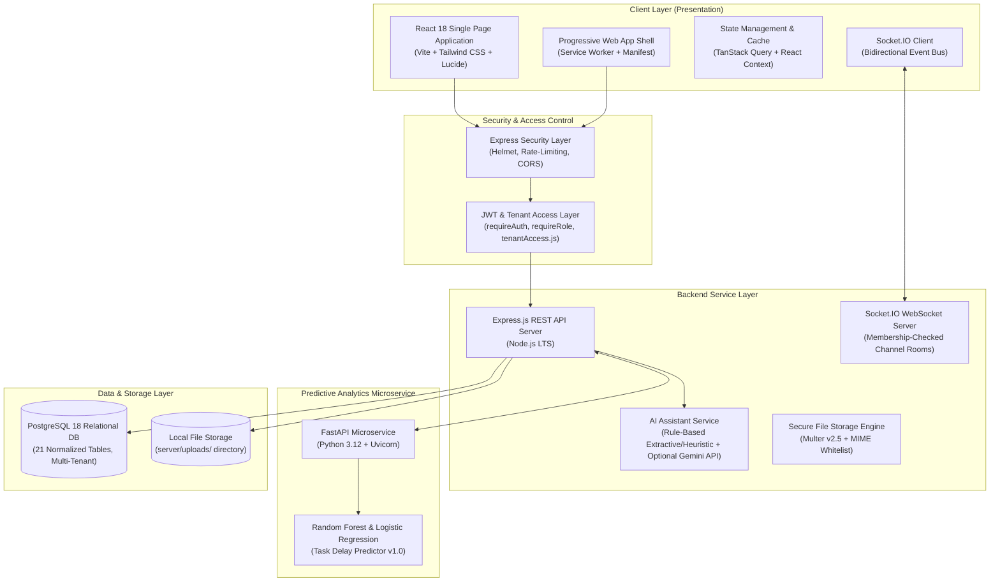
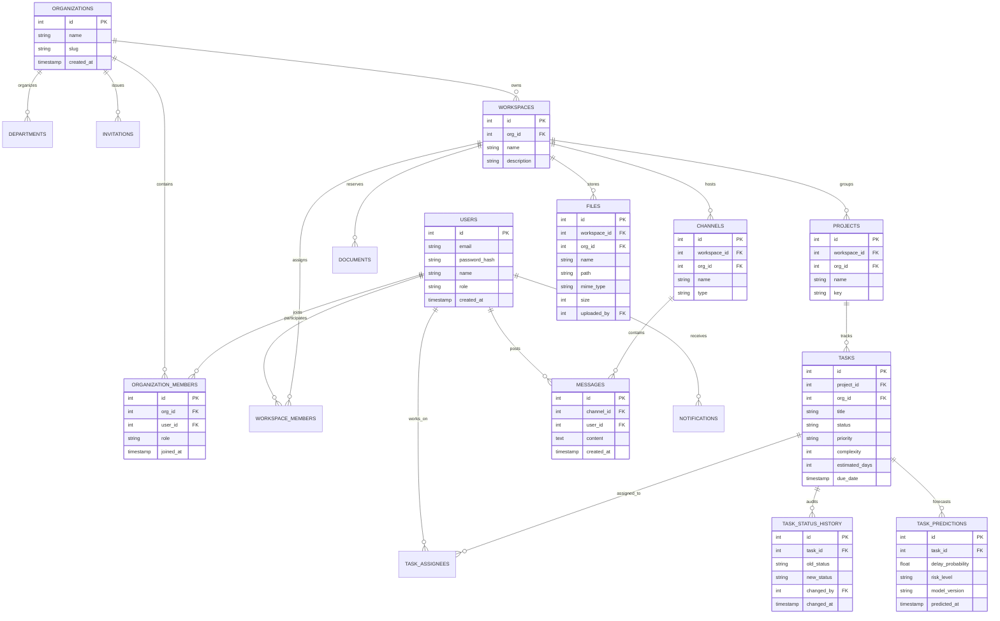
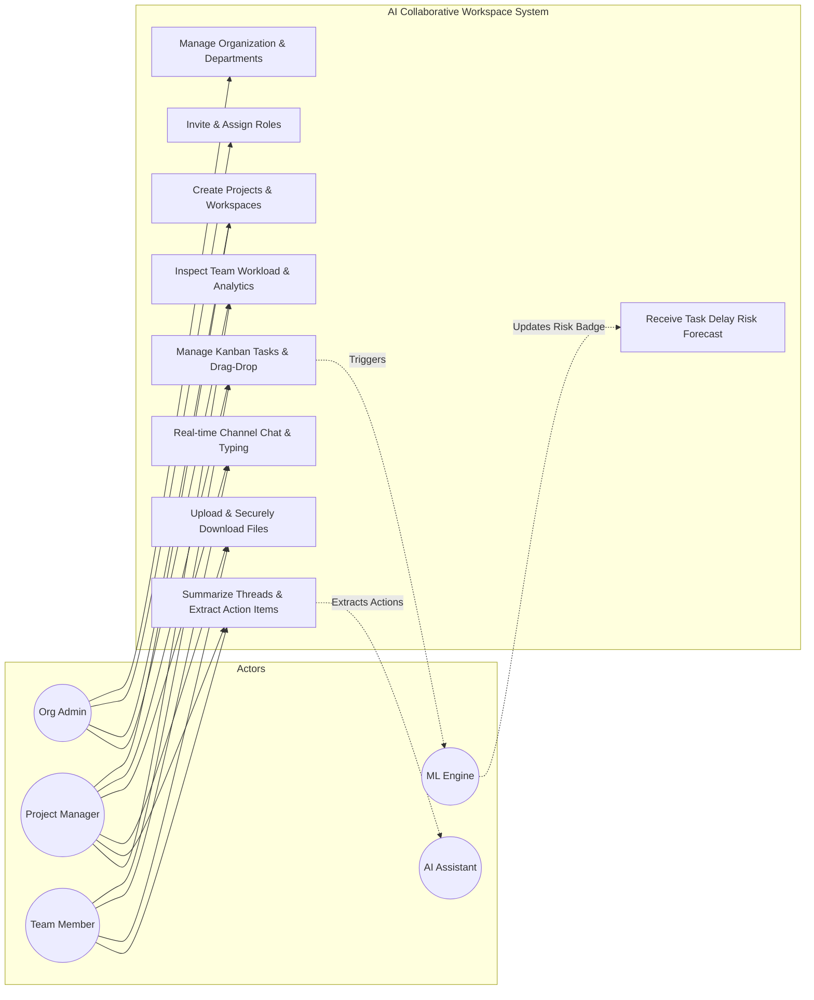
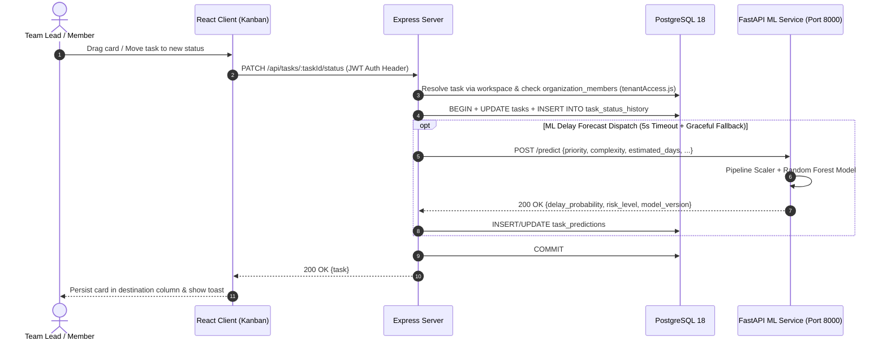
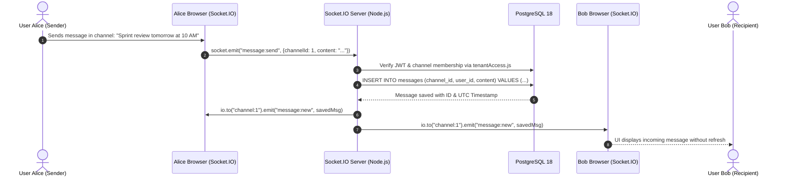
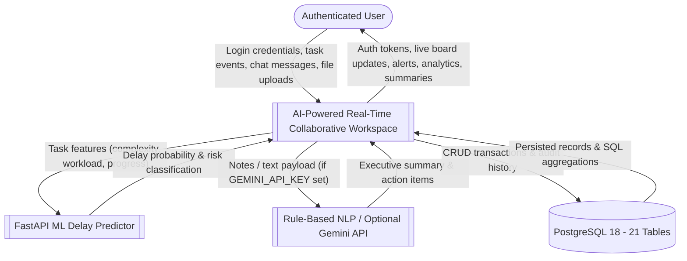
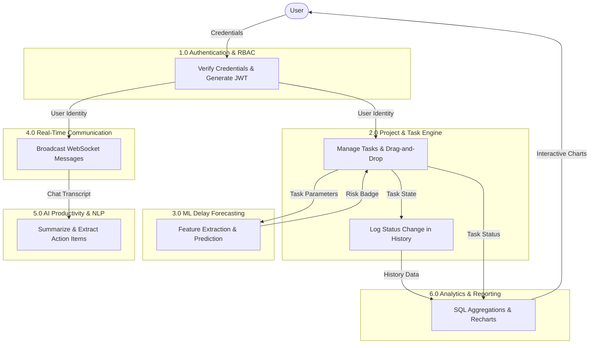

# System Architecture & UML Documentation
**Project Title:** AI-Powered Real-Time Collaborative Workspace with Predictive Analytics  
**Candidate:** Shivashankargoud B R (Reg No: KUB25MCA019)  
**Program:** Master of Computer Applications (MCA)  
**Institution:** Kishkindha University  

---

## 1. High-Level System Architecture

---

## 2. Entity-Relationship Diagram (ERD)

---

## 3. Use Case Diagram

---

## 4. Sequence Diagram: Task Creation & ML Delay Prediction

---

## 5. Sequence Diagram: Real-Time WebSocket Chat

---

## 6. Data Flow Diagrams (DFD)

### Level 0 DFD (Context Diagram)

### Level 1 DFD (Decomposed Functional Modules)

